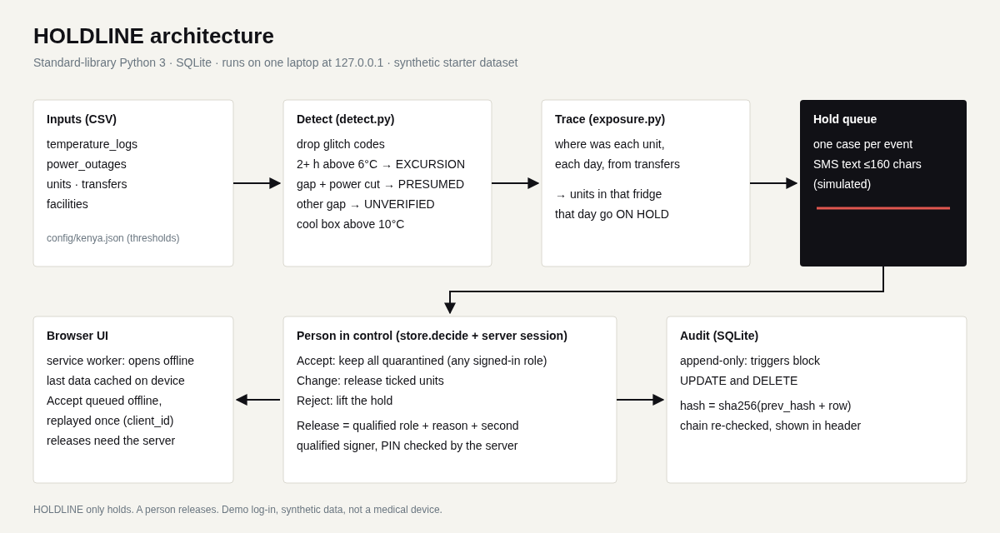

# HOLDLINE: the system holds, only a person releases

Terumo BCT Africa Hackathon 2026 · Challenge area: data quality and cold chain · Individual entry: Lebohang Loliwe

Status: **working prototype on synthetic data**. Not validated with real users or real fridges. Not a medical device.

## The problem
A blood fridge in a Kenyan county hospital goes above 6°C during a power cut. Today someone has to notice the chart, work out which units were inside, and stop them being issued. In the synthetic starter dataset (one year, 49,426 units):

- **7,112 units** were exposed to a temperature excursion (the dataset's own label, `units.temp_excursion_exposed`).
- **2,119 of them were transfused anyway.**
- Some exposures happen while the logger is silent: during a power cut the logger can stop writing while the fridge keeps warming, so the hourly log alone can under-report.
- The simple rule "any reading above 6°C, hold that fridge" also fires on one-hour spikes such as door openings and on sensor glitch codes (99.9): in this data 3 of every 4 of its holds are false.

User (hypothesis, not interviewed): the duty officer at a hospital blood bank, plus the blood bank manager who is qualified to release units.

## What we built
A working web app plus a tested Python engine:

1. **Excursion detector**: reads hourly fridge logs, drops known glitch codes, raises a hold on 2+ consecutive hours above 6°C.
2. **Logger-gap detector**: a silence of 3+ hours that overlaps a power cut without backup, or that ends above 6°C, becomes a *presumed* excursion. Other gaps are shown as *unverified* (no hold).
3. **Cool box check**: any transfer whose cool box went above 10°C holds that unit. On this dataset it fires **zero times**: no transfer records a cool box above 10°C.
4. **Auto-hold queue**: each event becomes a case listing every unit that was in that fridge on any day of the event. An event at a fridge with no units recorded is logged in the audit trail under "No units" and kept out of the decision queue.
5. **Person-in-control decision**: Accept (keep all quarantined), Change (release only ticked units) or Reject (lift the hold). Reason always required. A Change that lists a unit not in the case is refused and nothing is written. If a unit in the case is also held by another case, the case shows a cross-case warning: releasing it here does not clear the other hold. Only a qualified manager can release, and every release needs a second qualified person whose PIN the server checks. Identity comes from the server session, never from what the browser sends. Demo sessions expire (30 minutes idle, 8 hours at most), wrong PINs lock the user out for a while, and the server refuses cross-site, non-JSON and oversized requests. HOLDLINE never releases anything itself.
6. **Append-only, hash-chained audit log** in SQLite: database triggers block UPDATE/DELETE, and a SHA-256 chain exposes any edit made around the triggers. Shown live in the header.
7. **SMS fallback (simulated, nothing is sent)**: a 160-character-or-less alert per hold for sites with no data.
8. **Offline-tolerant UI**: app shell cached by a service worker, last data and the 20 newest open cases cached on the device, a decision to keep units on hold (Accept) made offline is queued and replayed with an idempotency key, so a retry is never applied twice. Releases can't be queued offline, because the server must check both signatures. Units stay on hold until then.

Mocked or not finished: SMS is not sent (no gateway); log-in is a **demo log-in** (three synthetic users with PINs in `holdline/config/demo_users.json`), not real authentication; sessions are in memory; the data is the organiser's synthetic set loaded at start-up, not a live logger feed.

Demo video (3 minutes or less): [to be recorded]
Live demo: not hosted, by decision (the starter kit has no public redistribution right). Run locally in under 2 minutes; the video shows it running.

## How to run it
Python 3.10+ only. No packages to install.

```
git clone <this repo> && cd holdline-terumo-2026
# put the organiser starter dataset CSVs in ./data (not committed: no redistribution licence)
python3 -m holdline.server data --port 8080 --since 2026-10-01
# open http://127.0.0.1:8080 (binds to 127.0.0.1 only; set HOLDLINE_HOST to change)
# demo log-in: demo.officer / 1111, demo.manager / 2222, demo.manager2 / 3333
python3 -m unittest -v tests.test_holdline tests.test_server tests.test_hardening                 # 61 tests (engine, HTTP, security hardening), no data needed
HOLDLINE_DATA=data python3 -m unittest -v tests.test_holdline tests.test_server tests.test_hardening   # 62: adds the end-to-end metrics check
python3 -m holdline.evaluate data                          # reproduces the numbers below
```

Try it: sign in as demo.manager, open a case, tick one unit, write a reason, choose demo.manager2 as second signer with PIN 3333, press Change. Then sign in as demo.officer, turn the network off in dev tools and Accept another case: it queues, then syncs.

## Architecture


Details: [docs/ARCHITECTURE.md](docs/ARCHITECTURE.md). What can fail and what happens then: [docs/FAILURE_MODES.md](docs/FAILURE_MODES.md).

```
temperature_logs, power_outages, transfers, units (CSV)
        │
   holdline/data.py ──► detect.py (glitch filter · persistence · gap + outage) ──► events
        │                                                         │
   exposure.py (where was each unit, each day) ◄──────────────────┘
        │
   store.py (SQLite: cases, case_units, audit[append-only, hash chain], sms_outbox)
        │
   server.py (stdlib HTTP, JSON API) ──► static UI (service worker + localStorage queue)
```

Where it sits: beside an existing blood bank information system, between the fridge logger and the issue desk. Units are referenced by ISBT 128-style unit IDs as given in the dataset; no FHIR or DHIS2 integration is built.

## AI and data
- **What it does**: a rule-based anomaly detector (glitch filtering, persistence, logger-gap inference from power-cut records). No machine-learning model: a transparent rule gives much higher precision than the baseline on this data, and every reason can be read.
- **Baseline**: "any hourly reading above 6°C puts that fridge-day on hold" (raw readings, as a person scanning the chart would).
- **Ground truth**: `units.temp_excursion_exposed` from the starter dataset. The generator sets it from the fridge's true simulated temperature (above 6°C for 4 consecutive hours marks the whole fridge-day), including hours the logger did not record, and from cool box peaks above 10°C. Our tracing is also day-level, which matches how the label is built; a real site would need hour-level stock movements.
- **Result, full year (49,426 units, 7,112 exposed)**, from `docs/metrics.json`:

| | Units held | Exposed caught (recall) | Precision | False holds | Exposed units held before their transfusion day (of 2,119) |
|---|---|---|---|---|---|
| Baseline | 28,619 | 96.9% | 24.1% | 21,727 | 2,038 |
| HOLDLINE | 10,259 | 95.4% | 66.1% | 3,473 | 1,984 |

What this shows: HOLDLINE holds **18,254 fewer units by mistake** at about the same recall. It is **not** better at stopping exposed units before use: on day-level timing it holds **54 fewer** exposed units before their transfusion day than the baseline. We make no claim that it prevents harm.

- **Check on later data only** (units collected from 2026-07-01, 1,611 exposed): baseline precision 16.2%, recall 96.8%; HOLDLINE precision 48.6%, recall 96.8%. Held before transfusion day: baseline 433, HOLDLINE 419 (of 459).
- Thresholds are **our chosen configuration** (`holdline/config/kenya.json`): 2 consecutive hours, a 3-hour gap, a 10°C cool box. The data dictionary only establishes the 2 to 6°C range. They were set before scoring and not tuned on the labels. No confidence probabilities are produced. HOLDLINE misses 106 more exposed units than the baseline (326 against 220) in exchange for 18,254 fewer false holds; that trade is stated, not hidden.
- **How a user sees the reason**: each case starts with how sure it is, "Measured", "Presumed, not measured" (logger gap during a power cut) or "Unknown" (shown, not held), then states the reason in words (for example RBTC-MSA on 2025-11-24: "Measured: 23 consecutive hourly readings above 6°C, peak 22.6°C"), with the 48-hour chart.
- **Who approves**: the duty officer can confirm a hold; only a qualified manager can release, with a second qualified signer verified by the server (demo log-in).
- **If the detector is wrong or offline**: a hold is the safe default, so a false hold costs a staff check. If the server is unreachable the device keeps the last view and queues Accept decisions; releases wait for the server. Missed events stay possible (326 in the year), so the manual fridge chart check is not removed.

## Data
The synthetic starter dataset only: `temperature_logs.csv`, `power_outages.csv`, `units.csv`, `transfers.csv`, `facilities.csv`. We used the synthetic starter dataset. No real donor, patient or facility data. The CSVs are not committed to this repo.

Data quality note: the dataset README says 60 sensor glitch readings; the file contains **55** (0.0 × 22, -99.0 × 17, 99.9 × 16). We report the 55 we counted.

## African conditions
- **Power**: power cuts are an input, not an afterthought; a cut without backup turns a logger gap into a hold.
- **Connectivity**: works offline after first load; decisions queue on the device; SMS fallback text fits one 160-character message, plain ASCII.
- **Phones**: responsive layout, 44 px touch targets, no frameworks (UI code about 21 KB plus fonts).
- **New site or country**: thresholds and rules live in `holdline/config/kenya.json`; a new country is a new config file.
- **Languages**: English only for now.

## AI tools we used
Built by Lebohang Loliwe, using AI coding agents (Claude via Quest, Grok, ChatGPT) under his direction.

- **Claude (Anthropic), through the Quest assistant**: wrote most of the code, tests and docs under the entrant's direction, and analysed the dataset.
- **Grok (xAI)**: project decisions (which build, demo, branding, publication timing) and review of claims.
- **ChatGPT (OpenAI)**: earlier research and planning notes outside this repo.
Every number in this README was produced by the code in this repo (`python3 -m holdline.evaluate`).

## Bundled third-party material
- IBM Plex Sans and IBM Plex Mono fonts (`holdline/static/fonts/`), SIL Open Font License 1.1, licence text in `holdline/static/fonts/OFL.txt`.
- No other third-party code; Python standard library only.

## Team
| Name | Role | Country | Presenting Friday (in person / online) |
|------|------|---------|-----------------------------------------|
| Lebohang Loliwe (individual) | Everything: product, build, data analysis | South Africa | TBC (finals demo after 11:10 EAT on 13 Nov; backup recorded demo of 3 min or less) |

## Known limits and next steps
- Synthetic data only; the user is a hypothesis; no clinician has reviewed the release rules.
- Day-level residency: a unit in the fridge any part of a day counts as in it for that day of the event.
- Two different counts: the header's "units in open holds" (9,910 on data since 2025-11-01) counts distinct units in open cases and leaves out units already expired on the day they sat in the fridge; the evaluation's 10,259 counts every unit on any flagged fridge-day of the whole year. They are different populations and are never compared.
- Glitch hours inside a hot run are bridged (tested); metrics unchanged on this data.
- Demo log-in only (synthetic users and PINs, in-memory sessions, no TLS): not real authentication. No live logger feed, no SMS gateway.
- No hosted demo: hosting needs the dataset on a public server, which the starter kit does not clearly permit.
- Next: probe-check step in the decision, Kiswahili interface, live logger ingest.
